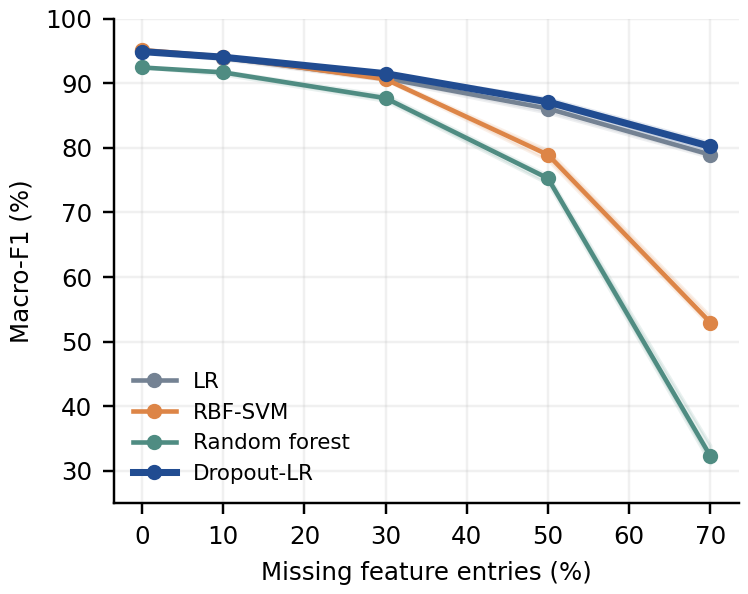
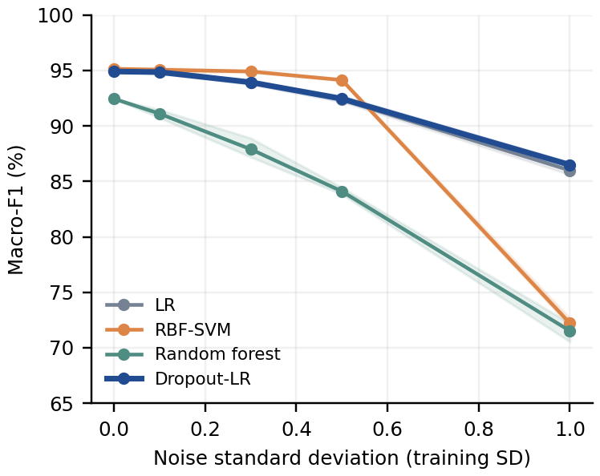
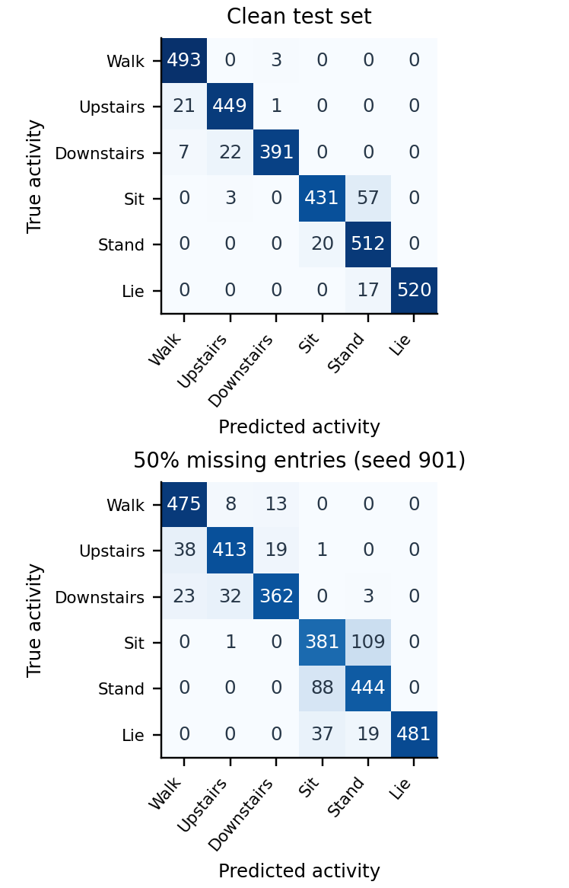

# Feature Dropout for Robust Smartphone Activity Recognition: A Subject-Disjoint Empirical Study

Anonymous manuscript - reproducible empirical study

## Abstract

Missing input features can change the behavior of activity recognizers even when clean-test accuracy is high. This study evaluates a simple feature-dropout augmentation procedure for multinomial logistic regression on UCI HAR. The official training and test partitions contain 21 and 9 distinct subjects, respectively. Three subject-disjoint validation folds select all model configurations using an equal-weight clean-and-corrupted macro-F1 criterion. Clean-trained logistic regression, an RBF support vector machine, and a random forest serve as baselines. Dropout-LR achieves 94.88% clean-test accuracy and 94.90% macro-F1. With 50% independently missing feature entries, its mean macro-F1 is 87.11%, 1.03 percentage points higher than the validation-selected comparator (LR); the paired subject-bootstrap 95% interval for the difference is [0.64, 1.44] points. We also report unseen additive-noise conditions, training-seed sensitivity, class errors and computation costs. The contribution is a reproducible empirical evaluation of an established augmentation principle, with explicit limits on generalization and physical-sensor interpretations.

Keywords: pattern recognition; human activity recognition; feature corruption; logistic regression; subject-disjoint validation; reproducibility.

## 1. Introduction

A supervised activity recognizer maps a vector of measurements to a discrete behavior label. The central pattern recognition tasks are choosing a representation, learning a decision rule and estimating how that rule generalizes. Recognition under incomplete inputs adds another question: does a classifier rely on a small set of features that may be unavailable at prediction time? Clean accuracy alone cannot answer this question.

We investigate this issue using the published feature representation of UCI HAR [1,2]. This makes the study practical on a laptop and separates classifier behavior from the engineering of a raw-signal feature extractor. The pipeline begins with the released numerical vectors and ends with reproducible predictions, stress-test curves and uncertainty estimates. It is not an end-to-end neural model or a live mobile application.

The main question is whether adding one randomly masked copy of each training example improves a linear classifier under feature loss without an unacceptable loss on clean data. A second question asks whether any benefit transfers to additive feature noise, which is absent from model selection. A third asks whether the result changes when the augmentation seed changes or when the unaugmented model uses exactly the same regularization parameter.

The study contributes a common subject-disjoint selection protocol for four methods; matched corruption realizations and a regularization-controlled augmentation comparison; and an auditable implementation with per-example outputs, subject-cluster intervals and measured computational costs. These are experimental contributions. No new learning algorithm, broad superiority claim or state-of-the-art record is asserted.

## 2. Related work and scope

Anguita et al. introduced the smartphone activity dataset and a multiclass SVM benchmark [1]. The repository provides the data and citation metadata [2]. Their work establishes the task; published headline scores are not treated as direct experimental baselines here because implementation and selection protocols can differ.

Subject identity is an important evaluation variable in activity recognition. Dehghani et al. discuss how ordinary sample-based cross-validation can overestimate performance when observations from the same subject are correlated [3]. We use subject-disjoint validation and retain the official held-out subjects. Uncertainty calculations also resample subjects rather than treating overlapping windows as independent experimental units.

Feature corruption during training is established prior work. Van der Maaten et al. optimize expected losses under corruption distributions in marginalized corrupted features [4]. Neural dropout is another influential application of random removal during training [5]. Our implementation uses a finite augmented dataset and a conventional multinomial logistic-regression solver. It does not implement marginalized optimization or neural-network dropout.

A more recent preprint by Saha et al. considers activity and subject recognition, missing data and imputation on UCI HAR [6]. This reinforces that missing-data robustness is not an unexplored problem. Our narrower study focuses on a matched comparison of classical classifiers, explicit subject separation and synthetic feature-entry corruption. The preprint is contextual related work; its numerical scores are not compared as though obtained under our protocol.

## 3. Data and method

## 3.1. Dataset and representation

The loaded dataset has 10,299 rows and 561 features. The official training partition has 7,352 rows from 21 subjects; the test partition has 2,947 rows from 9 other subjects. The six labels are listed in Table 1. Counts were verified from the downloaded files, and an explicit assertion checks that the subject sets do not intersect.

Table 1. Observed class counts in the official partitions.

| Activity | Train | Test |
| --- | --- | --- |
| Walking | 1226 | 496 |
| Walking upstairs | 1073 | 471 |
| Walking downstairs | 986 | 420 |
| Sitting | 1286 | 491 |
| Standing | 1374 | 532 |
| Lying | 1407 | 537 |

The original collection uses waist-mounted smartphone motion sensors at 50 Hz. Published features summarize 2.56-second windows with 50% overlap [1,2]. We retain the original feature order and supplied preprocessing. An additional StandardScaler is learned only from the relevant training rows. The original data contain no missing values; all evaluated missingness is synthetic.

## 3.2. Standardization and corruption

```text
z_ij = (x_ij - mu_j) / s_j
```

Here mu and s are the training feature mean and standard deviation; a constant feature uses the scaler's unit scale convention. For dropout, a Bernoulli mask is sampled independently for every row-feature entry. A removed standardized value is set to zero, which is equivalent to training-mean imputation in the supplied feature space.

```text
m_ij ~ Bernoulli(1 - p);   z_tilde_ij = m_ij z_ij
```

Retained entries are not divided by the retention probability. This is deliberate: the experiment models missing features imputed with their training mean, not expectation-preserving neural dropout. The inference command accepts NaN entries and performs the same mean imputation. Gaussian stress tests instead add independent zero-mean noise with standard deviation sigma in standardized feature units; these perturbed values are not clipped.

```text
z_tilde_ij = z_ij + epsilon_ij;   epsilon_ij ~ N(0, sigma^2)
```

## 3.3. Classifiers and augmentation

The linear classifier is L2-regularized multinomial logistic regression with an intercept, optimized using L-BFGS. Its clean counterpart uses the original standardized training matrix. Dropout-LR concatenates that matrix with one masked copy and repeats the labels. Each of the two copies receives sample weight 0.5, so the total sample weight remains the original training size n.

```text
J(W,b) = (1/n) sum_i [0.5 L(z_i,y_i) + 0.5 L(m_i*z_i,y_i)] + ||W||^2 / (2 C n)
```

L is multiclass cross-entropy; the intercept is unpenalized. C is scikit-learn's inverse regularization parameter. The masks are sampled once per fit and remain fixed during optimization. Weighting prevents a doubled dataset size from silently changing the effective regularization. A zero-dropout test verifies equivalence to clean training at the same C. The trained augmented model has the same inference architecture as ordinary logistic regression.

The other classifiers are an RBF-kernel SVM and a 200-tree random forest. The SVM uses gamma="scale" and does not fit probability calibration. The forest uses bootstrap sampling and unrestricted tree depth; its feature subsampling setting is selected on validation folds. All classifiers receive the same train-fitted standardized representation. Implementations use scikit-learn [7].

## 4. Experimental protocol

## 4.1. Selection without test tuning

The protocol is specified in config.json before the model run. Three GroupKFold partitions split the 21 training subjects, and a new scaler and classifier are fit in each fold. The validation score for a configuration is the mean of clean macro-F1 and corrupted macro-F1 at p=0.3. Corrupted validation scores average seeds 101, 102 and 103; the final selection score averages the three folds equally. Ties use grid order. The protocol is recorded locally and is not an external preregistration.

```text
S = mean_folds { [F1_clean + mean_seeds(F1_drop, p=0.3)] / 2 }
```

The candidate grids are C in {0.1,1,10} for both logistic models, training p in {0.1,0.3,0.5} for Dropout-LR, C in {1,10} for the SVM, and max_features in {sqrt,0.2} for the forest. Thus 16 configurations require 48 fits. The same scoring rule is applied to every model, although the augmented model has a larger search grid. The selected configurations are written to disk before the runner loads the official test arrays.

Table 2. Validation-selected parameters and mixed score S (%).

| Model | Selected setting | S |
| --- | --- | --- |
| LR | C=0.1 | 89.38 |
| RBF-SVM | C=1 | 88.38 |
| RF | max_features=sqrt | 87.09 |
| Dropout-LR | C=0.1, p=0.1 | 89.36 |

The baseline with the largest validation score is LR, so it is the primary comparator before test evaluation. Dropout-LR selects C=0.1 and p=0.1. Model and augmentation seeds are 2026 for final fitting and 2026 plus the fold index during validation. The test set is not used to revise the grid, corruption levels or primary comparator. Validation estimates used for selection are not presented as unbiased final performance.

## 4.2. Test conditions and metrics

Each selected model is retrained on all official training rows. The clean test condition is evaluated once. Feature-dropout rates are 0.1, 0.3, 0.5 and 0.7; noise standard deviations are 0.1, 0.3, 0.5 and 1.0. Every non-clean condition uses seeds 901, 902 and 903, matched across models. Curves report the mean across these three realizations; they are not averages over independently collected datasets. Gaussian corruption is not used during training or hyperparameter selection.

Accuracy counts correct windows. Macro-F1 is the arithmetic mean of the six classwise F1 scores, with absent denominators assigned zero. The main ablation trains clean logistic regression at the selected augmented C. Two further augmented fits use seeds 2027 and 2028 with unchanged hyperparameters. In total, seven fitted bundles are evaluated in 25 conditions each, giving 175 saved metric records.

## 4.3. Uncertainty and computational measurements

For each condition, 2,000 bootstrap samples draw nine test subjects with replacement. All windows for each drawn subject are included, with multiplicity. Macro-F1 is computed from the pooled confusion matrix for each corruption realization and then averaged across the fixed realizations. The 2.5th and 97.5th percentiles form the interval. Paired differences use the same resampled subjects for both classifiers (bootstrap seed 777).

These intervals express variability under resampling the observed subject clusters, conditional on the fitted models and corruption draws. They do not include retraining uncertainty or represent a confidence guarantee for all smartphone users. Only nine test subjects are available. Multiple stress conditions are descriptive and no multiplicity-adjusted familywise significance claim is made.

The experiment ran on Windows with Python 3.11.0, NumPy 1.26.4 and scikit-learn 1.5.2. Computation was limited to two threads for numerical libraries and the forest; no GPU was used. The recorded full-run time was 4.94 minutes. Fit times include scaling and augmentation. Prediction costs include scaling, use all 2,947 test rows as one batch, and report the median of five repetitions after a warm-up. They are not single-request latency or device-energy measurements.

## 5. Results

## 5.1. Clean performance

Table 3. Clean-test performance (%); intervals resample subjects.

| Model | Accuracy | Macro-F1 | 95% interval |
| --- | --- | --- | --- |
| LR | 94.98 | 95.00 | 91.70-97.61 |
| RBF-SVM | 95.22 | 95.15 | 92.73-97.26 |
| RF | 92.64 | 92.45 | 88.82-95.64 |
| Dropout-LR | 94.88 | 94.90 | 91.56-97.55 |

Dropout-LR obtains 94.88% accuracy and 94.90% macro-F1 on clean inputs. Relative to LR, its macro-F1 difference is -0.10 percentage points, with a paired 95% interval [-0.39, 0.17]. The evaluation objective balances clean and corrupted performance, so it does not select models solely to maximize clean accuracy. The marginal score intervals should not be substituted for the paired difference interval.

## 5.2. Feature-loss stress test

Table 4. Macro-F1 (%) averaged over three missingness masks.

| Model | 10% | 30% | 50% | 70% |
| --- | --- | --- | --- | --- |
| LR | 93.95 | 90.77 | 86.07 | 78.94 |
| RBF-SVM | 94.11 | 90.62 | 78.93 | 52.97 |
| RF | 91.68 | 87.69 | 75.28 | 32.29 |
| Dropout-LR | 94.04 | 91.49 | 87.11 | 80.22 |



Figure 1. Feature-loss robustness. Lines show mean macro-F1 and shaded bands the min-max range over three corruption seeds, not confidence intervals.

At 50% missing entries, Dropout-LR reaches 87.11% macro-F1 versus 86.07% for LR. The paired difference is +1.03 points [0.64, 1.44]. The interval excludes zero in favor of augmentation for this condition. Table 4 reports every specified missingness level, including severe corruption, to avoid selecting a single favorable point after inspecting the test results.

The masks remove entries independently within each window. A classifier can still exploit correlated retained features, which may explain resilience under substantial entry loss. This interpretation is a hypothesis consistent with the representation; the experiment does not directly measure feature redundancy or causal sensor contributions. Model rank at one corruption level should not be assumed to persist at another.

## 5.3. Transfer to additive noise

Table 5. Macro-F1 (%) under Gaussian feature noise.

| Model | 0.1 SD | 0.3 SD | 0.5 SD | 1.0 SD |
| --- | --- | --- | --- | --- |
| LR | 94.94 | 93.94 | 92.37 | 85.99 |
| RBF-SVM | 95.06 | 94.91 | 94.13 | 72.22 |
| RF | 91.10 | 87.90 | 84.10 | 71.53 |
| Dropout-LR | 94.85 | 93.93 | 92.45 | 86.49 |



Figure 2. Additive-noise stress test. The noise distribution was not used for selection. Shading shows the range across three noise realizations.

At sigma=1.0, the augmented model has 86.49% macro-F1 and the primary baseline has 85.99%. Their paired difference is +0.50 points [-0.16, 1.09]. Dropout and additive noise have different effects: masking moves entries exactly to the training mean, whereas noise can move them in either direction and beyond the observed range. Consequently, success under one perturbation is insufficient evidence of general robustness.

## 5.4. Ablations and class errors

The selected clean and augmented classifiers use the same C. Consequently, the matched-C ablation is identical to the selected clean LR model and supplies no additional independent model comparison. At 50% missingness, the augmented-minus-matched-C difference is +1.03 points [0.64, 1.44]. Maintaining total sample weight makes this comparison interpretable without a hidden regularization change from duplicating examples.

Table 6. Augmentation-seed sensitivity; macro-F1 (%).

| Train seed | Clean | 50% missing | Noise 1 SD |
| --- | --- | --- | --- |
| 2026 | 94.90 | 87.11 | 86.49 |
| 2027 | 95.00 | 87.36 | 86.65 |
| 2028 | 95.07 | 86.76 | 86.54 |

These additional seeds are sensitivity analyses, not a hyperparameter search. Seed 2026 remains the primary reported model. Three fits provide limited evidence about optimization and mask variability and do not replace repeated subject-split experiments. The subject bootstrap and training-seed table answer different uncertainty questions.

Table 7. Clean Dropout-LR class precision, recall and F1 (%).

| Activity | P | R | F1 |
| --- | --- | --- | --- |
| Walking | 94.63 | 99.40 | 96.95 |
| Upstairs | 94.73 | 95.33 | 95.03 |
| Downstairs | 98.99 | 93.10 | 95.95 |
| Sitting | 95.57 | 87.78 | 91.51 |
| Standing | 87.37 | 96.24 | 91.59 |
| Lying | 100.00 | 96.83 | 98.39 |



Figure 3. Dropout-LR confusion counts on clean inputs and one preselected 50% masking realization (seed 901). Color is normalized within each true class.

Class-level precision and recall identify which errors contribute to the aggregate score. The confusion matrices use the same underlying test windows; differences arise from the feature mask. The corrupted matrix is an illustration for the first fixed test seed, while the tables average all three seeds. A separate subject-results figure in the artifact exposes heterogeneity that aggregate window metrics can hide.

## 5.5. Computational cost

Table 8. Local resource measurements (single final fit).

| Model | Fit (s) | Batch us/row | Size (KiB) |
| --- | --- | --- | --- |
| LR | 1.00 | 3.71 | 37.7 |
| RBF-SVM | 1.48 | 653.95 | 9342.9 |
| RF | 11.59 | 14.81 | 2493.1 |
| Dropout-LR | 2.09 | 3.64 | 38.5 |

The augmented model fits twice as many rows as clean LR but stores a linear decision function at inference. The serialized size includes the scaler and classifier and uses joblib compression level 3. All timings were measured on the same host, but background load and implementation-specific threading remain potential sources of variation. Peak memory, power use and mobile deployment were not measured.

## 6. Limitations and reproducibility

External validity is limited by one benchmark, one official subject split, six activities and a small set of participants. The dataset's prepared representation and collection setup may not match other devices, body locations or free-living behavior. No inference should be made about unobserved activity classes, demographic groups, medical decisions or safety-critical deployment.

The perturbations operate after feature extraction and ignore time continuity and correlated sensor failure. A missing sensor may remove whole feature families over long intervals; independent feature entry masking does not simulate that mechanism. The method also assumes that missing values can be identified and imputed. Undetected corruption, biased missingness and adversarial perturbations were not tested.

Hyperparameter grids are deliberately small for laptop feasibility. The selected LR C is at a grid boundary, so a broader search could change the comparison; that search was not performed after seeing the test outcomes. The dropout method has more candidate settings than each baseline. Three validation folds and three corruption seeds are limited samples, and the nine-cluster percentile bootstrap may have unstable coverage. There is no formal power analysis or independent replication dataset.

The artifact records the dataset archive and member hashes, fold subject IDs, every validation score, selected parameters, fitted model bundles, all test predictions and metric tables. Configuration values and source hashes are included in the run manifest. Tests check train/test subject separation, corruption endpoints, training-only scaling, mean imputation, serialization, regularization equivalence, deterministic training and metric reconstruction from saved predictions. The implementation can therefore be audited without relying only on rounded manuscript numbers.

The public data are credited to their creators [1,2]; no new human data were collected. An original archive notice and the current repository licensing statement are both preserved in the project notes. Any claim about method novelty requires a broader literature assessment than this focused empirical study. The package is intended to make that further research easier, not to substitute for it.

## 7. Conclusion

This study implements and evaluates feature-dropout training for smartphone activity recognition under a subject-disjoint protocol. The selected model attains 94.90% clean macro-F1 and 87.11% macro-F1 at 50% independently missing entries. Relative to the validation-selected LR, the latter difference is +1.03 percentage points with interval [0.64, 1.44]. The interval excludes zero in favor of augmentation for this condition. The practical outcome is a small, reproducible comparison that makes robustness tradeoffs and uncertainty explicit. Additional datasets and structured raw-signal failures are needed before claiming broader deployment benefits.

## References

[1] D. Anguita, A. Ghio, L. Oneto, X. Parra, and J. L. Reyes-Ortiz, "A Public Domain Dataset for Human Activity Recognition Using Smartphones," ESANN, pp. 437-442, 2013. https://www.esann.org/sites/default/files/proceedings/legacy/es2013-84.pdf

[2] J. Reyes-Ortiz, D. Anguita, A. Ghio, L. Oneto, and X. Parra, "Human Activity Recognition Using Smartphones," UCI Machine Learning Repository, 2013. https://doi.org/10.24432/C54S4K

[3] A. Dehghani, T. Glatard, and E. Shihab, "Subject Cross Validation in Human Activity Recognition," arXiv:1904.02666, 2019. https://doi.org/10.48550/arXiv.1904.02666

[4] L. van der Maaten, M. Chen, S. Tyree, and K. Weinberger, "Learning with Marginalized Corrupted Features," ICML, PMLR 28(1), pp. 410-418, 2013. https://proceedings.mlr.press/v28/vandermaaten13.html

[5] N. Srivastava, G. Hinton, A. Krizhevsky, I. Sutskever, and R. Salakhutdinov, "Dropout: A Simple Way to Prevent Neural Networks from Overfitting," JMLR, vol. 15, pp. 1929-1958, 2014. https://jmlr.org/papers/v15/srivastava14a.html

[6] D. Saha, P. Malik, and A. Saha, "Activity and Subject Detection for UCI HAR Dataset with & without missing Sensor Data," arXiv:2505.06730, 2025. https://doi.org/10.48550/arXiv.2505.06730

[7] F. Pedregosa et al., "Scikit-learn: Machine Learning in Python," JMLR, vol. 12, pp. 2825-2830, 2011. https://www.jmlr.org/papers/v12/pedregosa11a.html
